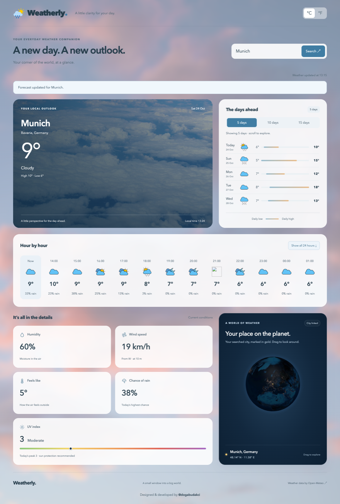

# Weatherly

A weather dashboard built with plain HTML, CSS and JavaScript (ES modules), with no framework and no build step. Search any city to see its current conditions, a 24-hour forecast, up to 15 days ahead, and its location on an interactive 3D globe.

**Live demo: [dogabudakci.github.io/weatherly](https://dogabudakci.github.io/weatherly/)**



## Features

- **City search with disambiguation:** when several places share a name, you choose the one you meant (for example Paris, France or Paris, Texas).
- **Current conditions:** temperature, feels-like, humidity, wind speed and direction, chance of rain, and the **UV index** with its WHO category on a color scale.
- **Hourly forecast:** the next 24 hours in a scrolling strip, or expanded into a grid.
- **5, 10 or 15-day forecast:** every day's range bar uses the same scale, so you can compare days at a glance.
- **°C / °F toggle:** the choice is saved in `localStorage`, and switching repaints from cached data without a new request.
- **Local time** in the searched city's own timezone.
- **3D globe** ([Globe.gl](https://globe.gl/)) that turns to the searched city.

## Implementation notes

- **No stale responses:** every search gets its own `AbortController`. Starting a new search cancels the old one, so a slow earlier response can't overwrite a newer one. Requests time out after 15 seconds and show a clear message.
- **Accessibility:** a skip link, `aria-live` status messages, `aria-pressed` and `aria-expanded` on toggles, labeled forecast rows for screen readers, visible keyboard focus, and support for `prefers-reduced-motion`.
- **Safe rendering:** text from the API is inserted with `textContent`, never as HTML.
- **Performance:** the globe library loads after the forecast, so weather is never blocked. The globe stops rendering when it is off-screen or the tab is hidden. All CDN dependencies are pinned to exact versions.
- **Graceful failure:** if WebGL or the CDN is unavailable, the dashboard still works and shows the coordinates as text.

## Project structure

```
index.html
style.css
js/
  main.js           Entry point: search flow, controls, error handling
  api.js            Open-Meteo geocoding and forecast requests
  render.js         Formatting and DOM rendering for the dashboard
  globe.js          Lazy-loaded 3D globe
  weather-codes.js  WMO weather code → description, photo, icon
  state.js          Shared app state
photos/             Background photos and weather icons
```

## Running locally

ES modules don't load from `file://` URLs, so serve the folder with any static server:

```bash
python3 -m http.server 8000
# then open http://localhost:8000
```

## Credits

- Weather and geocoding data: [Open-Meteo](https://open-meteo.com/) (free, no API key)
- 3D globe: [Globe.gl](https://github.com/vasturiano/globe.gl)
- Weather icons: [iconpacks.net](https://www.iconpacks.net/free-icon-pack/free-weather-icon-pack-199.html) (see [photos/weather-icons/SOURCES.md](photos/weather-icons/SOURCES.md))

Designed and developed by [@dogabudakci](https://github.com/dogabudakci).
